


 

## 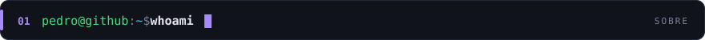

  

## 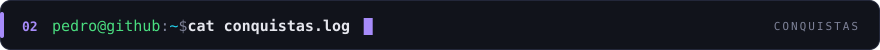

  

## 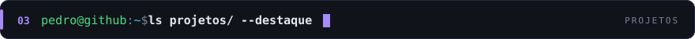

  <a href="https://github.com/dutrapedro06/krilltech"></a>
  <a href="https://github.com/dutrapedro06/LegixTech"></a>
  <a href="https://github.com/dutrapedro06/Machine-Learning"></a>
  <a href="https://github.com/dutrapedro06/HackatonCobol"></a>
  <a href="https://github.com/dutrapedro06/Compiladores"></a>
  <a href="https://github.com/dutrapedro06/TAA"></a>

## 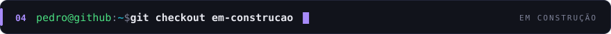

  
  
  
  

🔒 Repositórios privados enquanto estão em desenvolvimento.

## 

  

◆ **LINGUAGENS** 
<kbd>TypeScript</kbd> <kbd>Python</kbd> <kbd>JavaScript</kbd> <kbd>C</kbd> <kbd>C++</kbd> <kbd>Java</kbd> <kbd>COBOL</kbd> <kbd>SQL</kbd>

◆ **MOBILE E WEB** 
<kbd>React Native</kbd> <kbd>Expo</kbd> <kbd>HTMX</kbd> <kbd>Tailwind</kbd> <kbd>PWA</kbd>

◆ **BACKEND E BANCO DE DADOS** 
<kbd>FastAPI</kbd> <kbd>Flask</kbd> <kbd>Hono</kbd> <kbd>SQLAlchemy</kbd> <kbd>PostgreSQL</kbd> <kbd>Supabase</kbd> <kbd>Cloudflare Workers</kbd>

◆ **DADOS E IA** 
<kbd>Pandas</kbd> <kbd>NumPy</kbd> <kbd>scikit-learn</kbd> <kbd>XGBoost</kbd> <kbd>Jupyter</kbd> <kbd>Power BI</kbd> <kbd>Excel</kbd> <kbd>ETL</kbd>

◆ **FERRAMENTAS** 
<kbd>Git</kbd> <kbd>GitHub</kbd> <kbd>GitHub Actions</kbd> <kbd>Docker</kbd> <kbd>Linux</kbd> <kbd>WSL</kbd> <kbd>Playwright</kbd> <kbd>Vercel</kbd>

## 

  

  

  

  

## 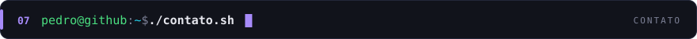

<em>Aberto a estágios, projetos e boas conversas sobre tecnologia.</em>

<a href="https://www.linkedin.com/in/pedro-pereira-dutra-0a2369322/">LinkedIn</a> ·
<a href="https://github.com/dutrapedro06/dutrapedro06/raw/main/curriculo-pedro-dutra.pdf">Currículo (PDF)</a> ·
<a href="https://github.com/dutrapedro06?tab=repositories">Repositórios</a>

  

