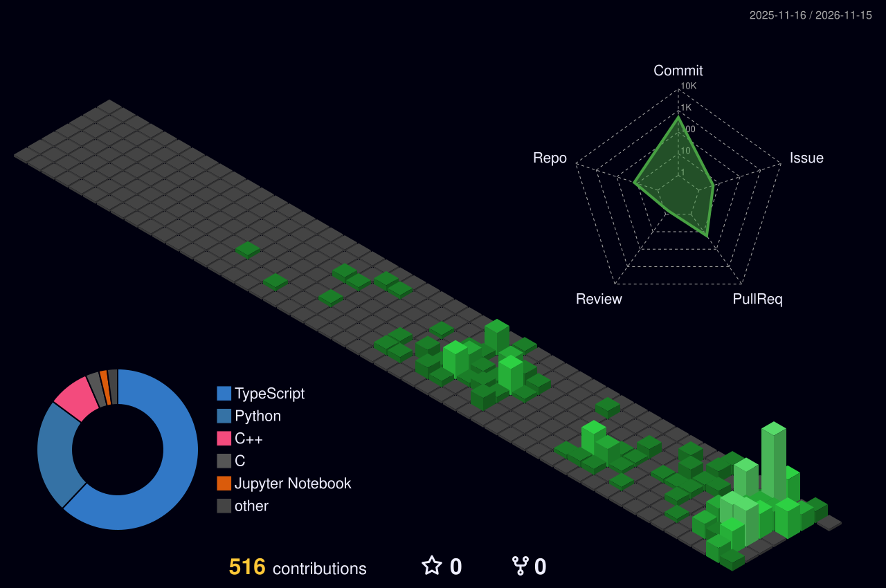

 

---

## 👋 Sobre mim

Sou **Pedro Pereira Dutra**, estudante do 6º semestre de **Ciência da Computação no IDP**, em Brasília, e **estagiário em Desenvolvimento de Software no SENAI — Departamento Nacional**. Gosto de construir **produtos de ponta a ponta**: apps mobile com **React Native e TypeScript**, backends em **Python/FastAPI** e serverless, e a camada de dados por trás deles. Também transito por **machine learning**, **COBOL/mainframe** e **algoritmos em C/C++**.

- 🥈 **2º lugar no Hackathon PMI-DF 2026** com o Krill Radar, IA para risco de crédito no agronegócio
- 🏦 Participei do **Hackathon COBOL da Stefanini**, com um sistema financeiro batch completo
- 🌎 Inglês avançado (C1)
- ⚡ **460+ commits em 2026**, entre projetos acadêmicos, pessoais e de trabalho

---

## 📊 Minha atividade no GitHub

 

---

## 💼 Experiência

**Estagiário em Desenvolvimento de Software · SENAI — Departamento Nacional** · ago/2026 – atual 
Automação de processos com Python, integração de sistemas via APIs, pipelines ETL e dashboards no Power BI para acompanhamento de indicadores, além de ferramentas internas para otimizar processos educacionais.

---

## 🏆 Conquistas

| | |
|:-:|---|
| 🥇 | **1º lugar — Melhor Pitch e Projeto** (IDP, 2024) com a startup WoofGo, + 1 ano no programa de incubação |
| 🥈 | **2º lugar — Hackathon PMI-DF 2026** com o Krill Radar |
| 🥉 | **3º lugar — Demoday IDP** (2024) |
| 🏅 | **4º lugar — Demoday IDP** (2025) |

---

## 🛠️ Tecnologias e ferramentas

**Linguagens**

**Mobile, web e backend**

**Dados, IA e bancos**

**DevOps, nuvem e ferramentas**

---

## 🚀 Projetos em destaque

| | Projeto | O que é | Stack |
|:-:|---|---|---|
| 🌾 | **[Krill Radar](https://github.com/dutrapedro06/krilltech)** | Protótipo que cruza dados de várias fontes e calcula indicadores de risco de crédito no agronegócio. **🥈 2º lugar no Hackathon PMI-DF 2026.** | JavaScript · Node · IA |
| ⚖️ | **[LegixTech](https://github.com/dutrapedro06/LegixTech)** | App de monitoramento legislativo: classifica projetos de lei por ODS (com fallback no Gemini) e gera resumos em linguagem simples. | FastAPI · PostgreSQL · React Native |
| 🤖 | **[Machine Learning](https://github.com/dutrapedro06/Machine-Learning)** | Classificação, regressão e clusterização com otimização em cascata, além de uma API Flask em Docker para prever a qualidade do ar. | Python · scikit-learn · XGBoost · Docker |
| 🏦 | **[Hackathon COBOL](https://github.com/dutrapedro06/HackatonCobol)** | Sistema financeiro batch: geração de dados, processamento de transações, validação, logs, extratos e saída em JSON. | COBOL · GnuCOBOL |
| 🛠️ | **[Compiladores](https://github.com/dutrapedro06/Compiladores)** | Construção das etapas de um compilador, começando por um analisador léxico para a linguagem MiniC. | C · C++ |
| 🧮 | **[TAA](https://github.com/dutrapedro06/TAA)** | Algoritmos e estruturas de dados: grafos, ordenação, recursão, bitwise e programação competitiva. | C · C++ |

### 🔒 Em desenvolvimento

| | Projeto | O que é | Stack |
|:-:|---|---|---|
| ⚽ | **Bola Cheia** | Sistema de agendamento de quadras e campos society, em PWA: o jogador reserva em poucos toques e o dono gerencia horários, preços e agenda, trocando o controle feito hoje pelo WhatsApp. Em validação com uma quadra de Brasília. | PWA · HTML · CSS · JavaScript |
| 💰 | **Gestão Financeira** | Finanças pessoais para uso diário: lançamento rápido pelo celular, dashboard e projeções, importação de extratos OFX, testes e CI. | FastAPI · SQLAlchemy · PostgreSQL · HTMX · Plotly · Docker |
| 🍳 | **Receitas** | App e site para guardar e compartilhar receitas com fotos e passo a passo, com espaços privados para família e amigos e uma área pública. | Expo · React Native · TypeScript · Supabase |
| ✅ | **Akto** | App de hábitos, tarefas e eventos, com conjuntos, progresso, lembretes e login com Google. Desenvolvido em dupla. | Expo · React Native · Hono · Cloudflare Workers |
| 🎓 | **Meu SENAI** | Protótipo de painel pedagógico: turmas, planejamento de aulas, engajamento e acompanhamento de desempenho. | HTML · CSS · JavaScript |

---

## 🌱 Estudando agora

- 🤖 Agentes de IA e LLMs aplicados
- ⚙️ Compiladores
- 🏗️ Arquitetura de software e processos
- 📊 Engenharia de dados (ETL) e Power BI

---

## 📫 Contato

